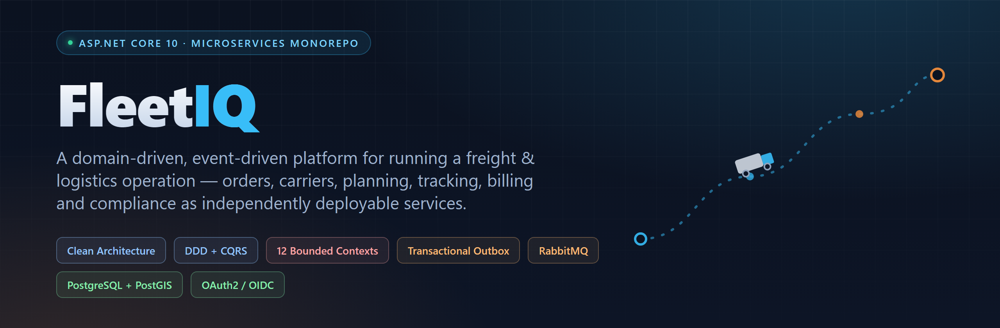
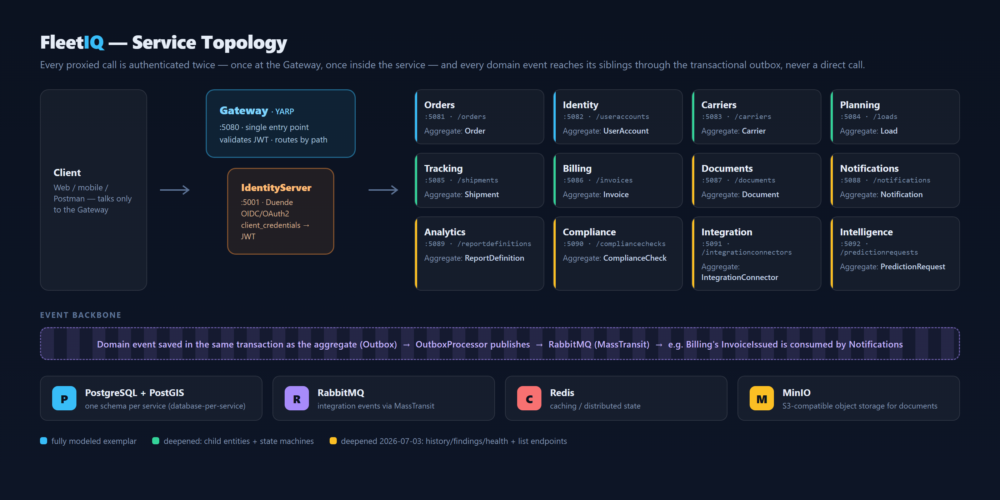
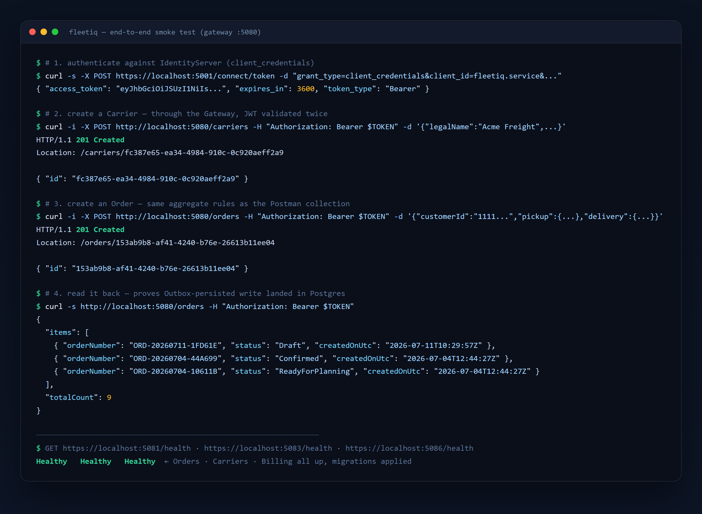

<p align="center">
  
</p>

<p align="center">
  
  
  
  
</p>

## What FleetIQ is

FleetIQ is a **backend platform for running a freight & logistics operation**: taking a customer
order, matching it to a carrier and a load, tracking the shipment, billing it, and keeping the
paperwork and compliance checks in order along the way.

It's built as a **microservices monorepo** — 12 independent services, one per business capability,
each owning its own database and publishing what happened as domain events instead of calling its
neighbors directly. There's no shared "god database" and no service reaching into another's tables;
every cross-service effect (e.g. *"an invoice was issued, so send a notification"*) travels through
a transactional outbox and RabbitMQ.

This repo is also meant to be **cloned from**: `Orders` and `Billing` are fully fleshed-out reference
services (rich aggregates, child entities, state machines, paged queries), and every other service
follows the same four-layer shape, so extending the system means copying a folder and modeling a new
aggregate — not inventing new plumbing.

## Architecture

<p align="center">
  
</p>

- **Single entry point**: clients only ever talk to the **Gateway** (YARP), which validates the JWT
  and routes by path prefix (`/orders` → Orders, `/carriers` → Carriers, etc).
- **Defense in depth**: the Gateway validates the token, and each service validates it *again* —
  a service is never reachable with an unauthenticated or forged token, even if someone bypasses
  the gateway on the internal network.
- **Auth**: **Duende IdentityServer** issues OAuth2/OIDC tokens (`client_credentials` for
  service-to-service calls). All services validate tokens identically via a shared
  `AddFleetIqJwtAuth()` extension.
- **Database-per-service**: every service owns a private Postgres schema. Nothing reads another
  service's tables directly.
- **Event-driven integration**: a domain event is written to an `outbox_messages` table in the
  *same transaction* as the aggregate change, then an `OutboxProcessor` publishes it to RabbitMQ
  (via MassTransit) — reliable, exactly-once-ish delivery with no dual-write problem. Example:
  `Billing` issues an invoice → publishes `InvoiceIssuedIntegrationEvent` → `Notifications`
  consumes it and creates a notification, all without the two services knowing about each other's
  internals.
- **Clean Architecture dependency rule** inside every service:
  `Api → Infrastructure → Application → Domain`. The Domain layer depends on nothing; Application
  defines interfaces (e.g. `IOrderRepository`), Infrastructure implements them.
- **CQRS without a mediator library**: hand-rolled `ICommand`/`IQuery` + handler contracts (no
  MediatR, no license risk), backed by a `Result` type so domain rule violations are returned, not
  thrown.

## Services

| # | Service | Aggregate | Route (via Gateway) | Port |
|---|---------|-----------|----------------------|------|
| 1 | Orders | `Order` | `/orders` | 5081 |
| 2 | Identity | `UserAccount` | `/useraccounts` | 5082 |
| 3 | Carriers | `Carrier` | `/carriers` | 5083 |
| 4 | Planning | `Load` | `/loads` | 5084 |
| 5 | Tracking | `Shipment` | `/shipments` | 5085 |
| 6 | Billing | `Invoice` | `/invoices` | 5086 |
| 7 | Documents | `Document` | `/documents` | 5087 |
| 8 | Notifications | `Notification` | `/notifications` | 5088 |
| 9 | Analytics | `ReportDefinition` | `/reportdefinitions` | 5089 |
| 10 | Compliance | `ComplianceCheck` | `/compliancechecks` | 5090 |
| 11 | Integration | `IntegrationConnector` | `/integrationconnectors` | 5091 |
| 12 | Intelligence | `PredictionRequest` | `/predictionrequests` | 5092 |

Plus **Gateway** (5080, entry point) and **IdentityServer** (5001, token endpoint).

`Orders` and `Billing` are the fully-modeled exemplars (value objects, child entities, paged/filterable
queries, state machines). `Carriers`, `Planning`, `Tracking` are similarly deepened. The remaining six
(`Documents`, `Notifications`, `Analytics`, `Compliance`, `Integration`, `Intelligence`) each have a
history/child-entity concept of their own (document versions, notification retries, report runs,
compliance findings, connector health, prediction confidence) plus list endpoints and domain unit tests.

## Tech stack

| Concern | Choice |
|---|---|
| Runtime | ASP.NET Core on **.NET 10** |
| Data access | EF Core (Npgsql) against **PostgreSQL + PostGIS** |
| Messaging | **RabbitMQ** via MassTransit (transactional outbox pattern) |
| Auth | **Duende IdentityServer** (OIDC/OAuth2) + JWT bearer validation |
| Gateway | **YARP** reverse proxy |
| Caching | Redis |
| Object storage | MinIO (S3-compatible, for Documents) |
| Observability | Serilog + OpenTelemetry (OTLP) + health checks |
| Testing | xUnit domain unit tests per service |
| CI | GitHub Actions — builds the solution and runs all tests on every push/PR |

## Running it

**Prerequisites**: [.NET 10 SDK](https://dotnet.microsoft.com/download), Docker Desktop.

```bash
./scripts/setup-secrets.ps1       # creates the git-ignored .env with random secrets
                                  # and loads them into the shared .NET user-secrets store
docker compose up -d              # Postgres(+PostGIS), RabbitMQ, Redis, MinIO
make init                         # generate FleetIQ.slnx project references
dotnet build FleetIQ.slnx

# schema migrations already exist in this repo; on first run each service applies
# its own migration automatically (Development environment)
dotnet dev-certs https --trust    # trust the local HTTPS dev cert, once

# run the core + every service (Windows)
./scripts/run-all.ps1
# ...or just the core to start (IdentityServer + Gateway)
./scripts/start-core.ps1
```

Front-end / API entry point: **http://localhost:5080**. Token endpoint:
**https://localhost:5001/connect/token**.

### Try it end-to-end

```bash
# 1. get a service token (the client secret lives in your local, git-ignored .env)
export $(grep '^FLEETIQ_SERVICE_CLIENT_SECRET=' .env)
TOKEN=$(curl -ks -X POST https://localhost:5001/connect/token \
  -d "grant_type=client_credentials&client_id=fleetiq.service&client_secret=$FLEETIQ_SERVICE_CLIENT_SECRET&scope=fleetiq.api" \
  | grep -oE '"access_token":"[^"]+"' | cut -d'"' -f4)

# 2. call a service THROUGH the gateway with the bearer token
curl -X POST http://localhost:5080/carriers \
  -H "Authorization: Bearer $TOKEN" -H "Content-Type: application/json" \
  -d '{"legalName":"Acme Freight","registrationNumber":"PT12345","country":"PT"}'

curl -X POST http://localhost:5080/orders \
  -H "Authorization: Bearer $TOKEN" -H "Content-Type: application/json" -d '{
    "customerId": "11111111-1111-1111-1111-111111111111",
    "pickup":   {"street":"1 Main St","city":"Lisbon","postalCode":"1000-001","country":"PT"},
    "delivery": {"street":"5 Park Ave","city":"Porto","postalCode":"4000-002","country":"PT"},
    "items":    [{"description":"Pallet","quantity":2,"weightKg":120}]
  }'
```

This is exactly the flow captured below on a running instance of this repo — token issued by
IdentityServer, both writes accepted by the Gateway, and the new order immediately visible in the
paged list:

<p align="center">
  
</p>

Prefer a GUI? Import [`FleetIQ.postman_collection.json`](FleetIQ.postman_collection.json) — run
**"0 - Get Token"** first (it saves the bearer token for you), then any service folder. Every
request goes through the Gateway, i.e. exactly the surface a front-end would use. Each service also
publishes its raw OpenAPI document at `/openapi/v1.json`.

### Adding the next service

1. Copy `src/Services/Orders` → `src/Services/<NewService>`, rename namespaces/projects.
2. Model the aggregate(s) in `*.Domain`.
3. Add its database to `docker-compose.yml` / `scripts/postgres-init`.
4. Re-run `make init` (or `dotnet sln add` the new projects).

## Testing

```bash
dotnet test FleetIQ.slnx
```

Runs the xUnit domain unit-test suite for every service (lifecycle rules, invariants, state
transitions). CI runs the same command on every push and pull request.

## Repository layout

```
fleetiq/
  docker-compose.yml            # Postgres(+PostGIS) · RabbitMQ · Redis · MinIO
  Directory.Packages.props      # central NuGet versions
  src/
    BuildingBlocks/             # shared Domain/Application/Infrastructure/Web building blocks
    Contracts/                  # shared integration-event contracts (published/consumed via the bus)
    IdentityServer/             # Duende IdentityServer — issues tokens
    Gateway/                    # YARP reverse proxy — single entry point
    Services/
      Orders/                   # reference service — copy this for the next bounded context
        *.Domain                # Order aggregate, value objects, domain events
        *.Application           # commands/queries, validators
        *.Infrastructure        # EF Core (Npgsql), repository, DbContext, outbox
        *.Api                   # Minimal API endpoints, health, OpenAPI, OTel
      Carriers/ Planning/ Tracking/ Billing/ Documents/ Notifications/
      Analytics/ Compliance/ Integration/ Intelligence/ Identity/
  tests/
    FleetIQ.<Service>.UnitTests # xUnit domain tests, one project per service
```

## Notable design decisions

- **No MediatR / AutoMapper** — both went commercial in 2025 (free under $5M revenue). This scaffold
  uses a hand-rolled mediator and maps DTOs by hand instead.
- **MassTransit v8** (Apache-2.0) is used for the bus; v9 goes commercial above ~$1M revenue.
  [Wolverine](https://wolverinefx.net/) (MIT) is the drop-in alternative if that matters to you.
- **Duende IdentityServer** is free under a $1M revenue threshold; [OpenIddict](https://github.com/openiddict)
  is the free fallback if you outgrow that.

See [`FOUNDATION.md`](FOUNDATION.md) and [`SERVICES.md`](SERVICES.md) for more detail on the edge/auth
layer and the current state of each bounded context.
